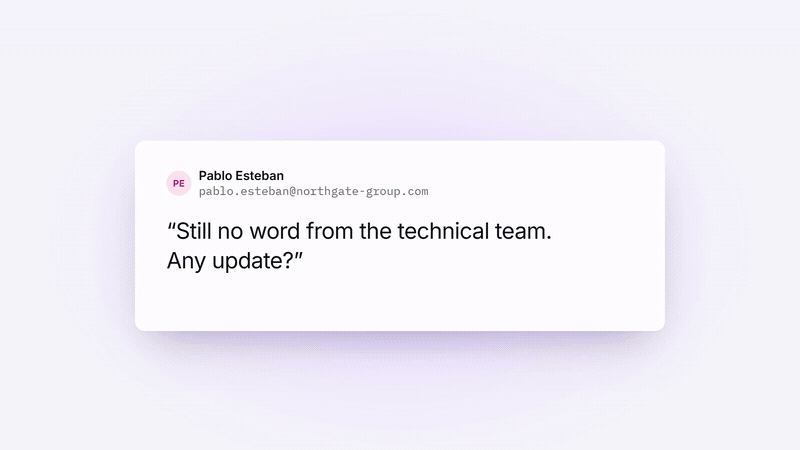
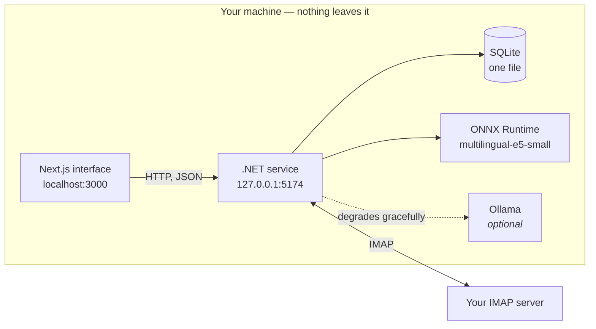

# LocalMail AI

Email triage that runs entirely on your machine. It reads your mailbox over IMAP,
sorts it into four buckets, explains every decision in plain language, and writes the
result back as ordinary IMAP labels you can see in Gmail, Apple Mail or on your phone.

**Nothing is uploaded anywhere.** The only network traffic is to your own mail server.

---

## Demo



Thirty-five seconds, start to finish: a buried inbox, the four buckets, the reasons
behind each decision, and a correction teaching the classifier.

---

## What it is

A mailbox mixes three kinds of message that need completely different handling:
messages someone is waiting on you for, messages worth reading once, and machine
traffic. Separating them costs time every day.

The two existing options each force a trade-off this avoids:

- **Server-side filters** (Gmail rules, Sieve) only match what you can write down as a
  rule. They cannot tell a client waiting for a reply from a newsletter sent by the
  same domain.
- **Hosted AI assistants** classify well, but you have to upload your mailbox to a
  third party. For legal, medical or client correspondence that is often not allowed.

LocalMail AI classifies locally, and reports **why** for every decision — "you have
replied to this sender 12 times", "you are in Cc, not To", "third message with no
reply from you" — so a wrong answer is something you correct, not a black box.

It is **not** a mail client. It does not compose, reply, send or delete, and it does
not handle attachments, contacts or calendars. It computes labels and proposes them.

## What it does

| Bucket | Meaning |
|---|---|
| `reply` | Someone is waiting for a reply from you |
| `fyi` | Worth reading, no reply needed |
| `automated` | Machine mail you actually read — deploys, tickets, bank notices |
| `noise` | Marketing and newsletters |

Three behaviours matter as much as the buckets:

- **It admits when it does not know.** Below 0.55 confidence a message goes to a "not
  sure" drawer instead of being guessed into a bucket.
- **Corrections teach it.** Moving a message to the right bucket retrains the
  classifier in place, in about 7 ms. Corrections are stored as events, so undo is
  just the inverse event.
- **Nothing moves on its own.** Labels reach your IMAP server only when you explicitly
  ask, in a batch you confirm.

## What the project contains

```
localmail-ai/
├── backend/     .NET 10 service — IMAP, classification, API, SQLite
├── frontend/    Next.js 16 + React 19 interface
└── BACKEND.md   the specification — the backend source cites it by section
```

**`backend/`** — the whole service, usable on its own over `curl`:

| | |
|---|---|
| `src/LocalMailAI.Api/` | The service: API, classification, repositories, MIME parsing, ONNX embedder, SQL migrations, DPAPI credential store |
| `tests/` | 119 xunit tests |
| `tools/` | Tokenizer and embedding parity checks, plus an evaluator reporting per-bucket precision, recall and F1 |
| `fixtures/` | 18 sample `.eml` messages, so you can try it with no mail account |
| `eval/`, `lab/` | Labelled evaluation set and the Python reference scripts |

**`frontend/`** — the interface, a thin client. All triage logic lives in the backend,
so there is exactly one place where a rule can be wrong. The TypeScript types in
`frontend/src/lib/mock.ts` are the data contract the backend returns.

## How it works



Messages run through a pipeline ordered by increasing cost — IMAP fetch, MIME parse,
normalisation, deterministic signals, embedding, classifier. **A usable answer exists
after the signals stage**, before any model runs, so triage works from minute zero.

The classifier is a logistic regression over the embedding plus the signal vector, not
a language model: more accurate here, far faster, and retrainable in place after every
correction. Ollama is only used for optional summaries and extraction — without it the
product works, just without those two features.

| Component | Implementation |
|---|---|
| Classification | Deterministic header signals + logistic regression (SGD) |
| Embeddings | `multilingual-e5-small`, ONNX Runtime, 384 dimensions |
| Search | BM25 (SQLite FTS5) + vector similarity, fused with RRF |
| Storage | SQLite, a single file |
| Mail | MailKit / MimeKit |

## Requirements

| | |
|---|---|
| **OS** | Windows 10 or 11 — credential storage uses DPAPI |
| **.NET SDK** | 10.0 or later |
| **Node.js** | 20 or later |
| **Python** | 3.10 or later — only to fetch the model, once |
| **Disk** | About 2 GB |
| **Mailbox** | IMAP enabled, and an **app password** — not your normal password |
| **Ollama** | Optional. Without it you lose summaries and extraction, nothing else |

> **App password:** Gmail, Outlook and most providers require a dedicated password for
> IMAP clients, created in your account's security settings with two-factor
> authentication enabled. Your normal password will not work.

## Install

```powershell
git clone https://github.com/wuzupKev/localmail-ai.git
cd localmail-ai
```

**1 — the embedding model** (470 MB, once):

```powershell
pip install transformers onnxruntime
python backend\lab\dump_reference.py
curl.exe -L -o backend\models\multilingual-e5-small\onnx\model.onnx `
  https://huggingface.co/intfloat/multilingual-e5-small/resolve/main/onnx/model.onnx
```

**2 — your mail account.** Interactive; the password is never echoed, never written to
a config file and never sent over HTTP:

```powershell
cd backend
dotnet run --project src\LocalMailAI.Api -- --add-account
```

**3 — the interface:**

```powershell
cd ..\frontend
npm install
```

## Using it

Two windows, both from the repository root.

```powershell
# Window 1 — the service. Creates and migrates the database on first run.
cd backend
dotnet run --project src\LocalMailAI.Api          # http://127.0.0.1:5174
```

```powershell
# Window 2 — the interface
cd frontend
npm run dev                                       # http://localhost:3000
```

Check the service is alive:

```powershell
curl.exe http://127.0.0.1:5174/api/health         # {"status":"ok","version":"0.1.0"}
```

Running the backend on a different port? Create `frontend/.env.local`:

```
NEXT_PUBLIC_API_URL=http://127.0.0.1:5174
```

### Try it without a mail account

18 sample messages ship with the repository:

```powershell
cd backend
python lab\build_fixtures.py
dotnet run --project src\LocalMailAI.Api -- --seed fixtures
dotnet run --project src\LocalMailAI.Api
```

Measure the classifier against the labelled set:

```powershell
dotnet run --project tools\Evaluate -- --emails fixtures --labels eval\fixtures-18.json
```

Run the tests:

```powershell
dotnet test tests\LocalMailAI.Tests
```

## API

Base URL `http://127.0.0.1:5174`. JSON, camelCase, UTF-8. Binds to localhost only.

| Endpoint | Purpose |
|---|---|
| `GET /api/health` | Liveness |
| `GET /api/emails?bucket=&limit=&cursor=` | Inbox, cursor-paginated |
| `GET /api/emails/{id}` | A single message |
| `PATCH /api/emails/{id}` | Mark read or unread — this also feeds triage |
| `GET /api/counts` | Per-bucket counts |
| `POST /api/emails/{id}/classification` | Correct a classification |
| `POST /api/corrections/undo` | Undo the last correction |
| `GET /api/model/status` | Example counts, precision, model availability |
| `POST /api/sync` | Starts an IMAP pass; poll `GET /api/sync/status` |
| `GET /api/labels/pending` | Messages whose bucket differs from the last one written |
| `POST /api/labels/apply` | The only call that writes to your mail server |
| `POST /api/emails/{id}/summary` | Summarises the thread; `503` without Ollama |

`bucket` accepts the four bucket names plus `unsure` for below-threshold messages.
Errors are `{"error": {"code", "message"}}` with the matching HTTP status.

## Security model

- **Network egress is limited to your IMAP server and localhost.** No telemetry, no
  analytics, no crash reporting, no CDNs. ⚠️ The automated test enforcing this is
  specified but **not written yet** — today it is a design rule, not a verified
  guarantee.
- **IMAP passwords are encrypted with DPAPI** at user scope, stored outside the
  database. The database holds only a lookup key, which does not contain the address.
- **Account setup is a console command, not an HTTP endpoint**, so the password never
  travels over HTTP and never reaches a request log.
- **The service binds to `127.0.0.1` only.**

## Status

Pre-release. The triage path works end to end against the bundled fixtures; **IMAP
synchronisation is the main gap** between this and daily use.

**Working:** signal-based triage, the API above, corrections with undo, full-text
search, account setup with live IMAP verification, IMAP synchronisation, label
write-back, and thread summaries when Ollama is installed.

**Not yet:** the trained classifier, vector search fused with BM25, extraction,
multiple accounts.

The honest caveat is accuracy, not plumbing: every message is still classified by the
deterministic signals alone (`model_version` 0). That is enough to put newsletters in
`noise`, and not enough to tell a deploy notification from a client waiting on you.

Per-milestone detail, measured numbers and the reasoning behind each decision are in
[backend/README.md](backend/README.md).

## Licence

Undecided.
