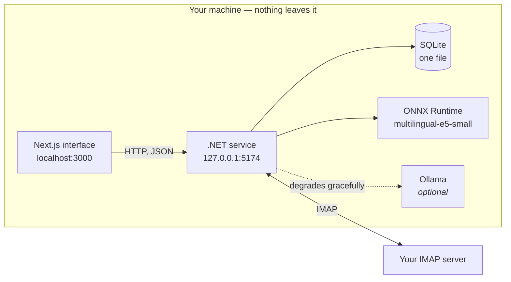
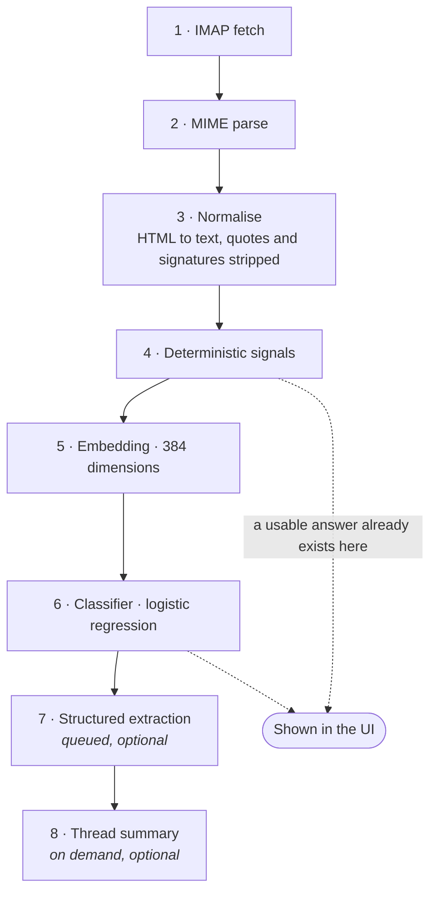

# LocalMail AI

Email triage that runs entirely on your machine. It reads your mailbox over IMAP,
sorts it into four buckets, explains every decision in plain language, and writes the
result back as ordinary IMAP labels you can see in Gmail, Apple Mail or your phone.

Nothing is uploaded anywhere. The only network traffic is to your own mail server.

- [What it solves](#what-it-solves)
- [What it does](#what-it-does)
- [How it works](#how-it-works)
- [Repository layout](#repository-layout)
- [What is in the backend](#what-is-in-the-backend)
- [Requirements](#requirements)
- [Install](#install)
- [Running it](#running-it)
- [Trying it without a mail account](#trying-it-without-a-mail-account)
- [API](#api)
- [Security model](#security-model)
- [Status](#status)

---

## What it solves

A mailbox mixes three kinds of message that need completely different handling:
messages someone is waiting on you for, messages worth reading once, and machine
traffic. Separating them costs time every day, and the cost grows with volume.

The two existing options each force a trade-off this avoids:

- **Server-side filters** (Gmail rules, Sieve) only match what you can write down as a
  rule. They cannot tell a client waiting for a reply from a newsletter sent by the
  same domain.
- **Hosted AI assistants** classify well, but you have to upload your mailbox to a
  third party. For legal, medical or client correspondence that is often simply not
  allowed.

LocalMail AI classifies locally. No message, header or body leaves the machine.

It also reports **why** for every decision — "you have replied to this sender 12
times", "you are in Cc, not To", "third message with no reply from you" — so a wrong
answer is something you can correct, not a black box you have to accept.

## What it does

| Bucket | Meaning |
|---|---|
| `responder` | Someone is waiting for a reply from you |
| `informativo` | Worth reading, no reply needed |
| `automatizado` | Machine mail you actually read — deploys, tickets, bank notices |
| `ruido` | Marketing and newsletters |

Three behaviours matter as much as the buckets themselves:

**It admits when it does not know.** Messages below 0.55 confidence are not assigned to
any bucket. They go to a separate "not sure" drawer, so the system says *I don't know*
instead of guessing. The rule lives in one place in the backend, so a bucket's count
always matches the list that count opens.

**Corrections teach it.** When you move a message to the right bucket, the correction
is stored as an event and retrains the classifier in place — currently in about 7 ms,
against a 300 ms budget. Corrections are events rather than overwritten labels, so
undo is just the inverse event, and the training history is never lost.

**Nothing moves on its own.** The service computes labels and proposes them. They are
written to your IMAP server only when you explicitly ask, in a batch you confirm.

### What it does not do

It is not a mail client. It does not compose, reply, send or delete, and it does not
handle attachments, contacts or calendars. Out of scope on purpose: drafting replies,
moving mail automatically, multiple accounts, OAuth, calendar and mobile.

## How it works

Two local processes and one database:



The interface is a thin client: it renders what the service decides. All triage logic,
thresholds and storage live in the backend, so there is exactly one place where a rule
can be wrong.

### The ingestion pipeline

Stages are ordered by increasing cost. Each one writes to the database and is
resumable, so a message is never stuck halfway:



Two consequences worth knowing:

- **Triage works from minute zero.** Step 4 alone already produces an answer, before
  any model runs. The model improves the result; it is not required for one to exist.
- **The language model is never on the critical path.** Steps 7 and 8 are the only ones
  that use it, both are optional, and if Ollama is absent the product keeps working —
  just without extraction and summaries. Most users will not have a GPU, so this is
  tested from the start rather than assumed.

### Why a classifier and not the language model

| Component | Implementation |
|---|---|
| Classification | Deterministic header signals + logistic regression (SGD) |
| Embeddings | `multilingual-e5-small`, ONNX Runtime, 384 dimensions |
| Search | BM25 (SQLite FTS5) + vector similarity, fused with RRF |
| Summaries, extraction | Ollama — optional |
| Storage | SQLite, a single file |
| Mail | MailKit / MimeKit |

The classifier is a logistic regression over the embedding concatenated with the signal
vector. For this task that is more accurate than prompting a language model, orders of
magnitude faster, and — the deciding reason — **retrainable in place** after every
correction. A language model cannot learn from your correction without being retrained
or re-prompted with a growing history. The LLM only does generative work.

## Repository layout

```
localmail-ai/
├── backend/        .NET 10 service — IMAP, classification, API, SQLite
├── frontend/       Next.js 16 + React 19 interface
├── docs/
│   └── INSTALL.md  step-by-step installation, per-provider app passwords
├── video/          HyperFrames launch film — script, compositions, assets
└── BACKEND.md      the backend specification, and the contract between the two
```

`BACKEND.md` is the authoritative specification. The TypeScript types in
`frontend/src/lib/mock.ts` are the data contract: the backend returns exactly those
shapes, which is why the interface could be built before the service existed.

## What is in the backend

.NET 10, ASP.NET Core Minimal APIs, Dapper over SQLite. No EF Core, no Semantic Kernel,
no LangChain, no Docker, no cloud service — by design, and stated as such in the spec.

```
backend/
├── src/LocalMailAI.Api/
│   ├── Accounts/        interactive IMAP account setup
│   ├── Api/             DTOs matching the frontend contract
│   ├── Classification/  deterministic signals and the baseline classifier
│   ├── Data/            SQLite access, migrations, repositories
│   ├── Embeddings/      ONNX embedder and pooling
│   ├── Mail/            MIME parsing, body normalisation, ingestion
│   ├── Migrations/      versioned .sql schema, embedded in the assembly
│   ├── Model/           model availability and status
│   └── Security/        DPAPI credential store
├── tests/               119 xunit tests
├── tools/
│   ├── TokenizerParity/ proves the tokenizer matches the Python reference
│   ├── EmbeddingParity/ proves the embeddings match, plus a ranking demo
│   └── Evaluate/        per-bucket precision, recall, F1, confusion matrix
├── fixtures/            18 sample .eml messages
├── eval/                labelled evaluation sets
└── lab/                 Python reference scripts — not shipped
```

### How the classification actually works

Four header signals answer one question — *is someone waiting on you?* — and they
answer it well. On the labelled 18-message set, `responder` scores **1.00 precision and
1.00 recall with no model involved at all**.

The other three buckets are harder, and the reason is worth stating plainly:

> `responder` versus the rest is an **objective property of the message**: someone is
> waiting on you, or they are not.
>
> `informativo`, `automatizado` and `ruido` are all "mail you do not reply to". What
> separates them is **how much you personally care**, which appears in no header. All
> three carry `List-Unsubscribe`, all three come from machines; the deploy notice gets
> read and the promotion does not.

The first axis belongs to the message, the second to the user. That is why one works
immediately and the other needs history. The signal that supplies the second axis is
`sender_stats.opened`, fed by the read-state `PATCH` — **you reading your mail is what
trains the system**, with no extra work from you.

Measured baseline, deterministic signals only, before the trained classifier exists:

| Metric | Value |
|---|---|
| Coverage — commits to an answer | 56% |
| Accuracy over covered messages | 90% |
| Macro precision | 0.667 |
| Macro F1 | 0.700 |

## Requirements

| | |
|---|---|
| **OS** | Windows 10 or 11 — credential storage uses DPAPI |
| **.NET SDK** | 10.0 or later |
| **Node.js** | 20 or later |
| **Python** | 3.10 or later — only to fetch the model, once |
| **Disk** | About 2 GB |
| **Mailbox** | IMAP enabled, and an **app password** (not your normal password) |
| **Ollama** | Optional. Without it you lose summaries and extraction, nothing else |

## Install

```powershell
git clone https://github.com/wuzupKev/localmail-ai.git
cd localmail-ai
```

**1 — the embedding model** (470 MB, once):

```powershell
pip install transformers onnxruntime
python backend\lab\dump_reference.py
curl.exe -L -o backend\models\multilingual-e5-small\onnx\model.onnx `
  https://huggingface.co/intfloat/multilingual-e5-small/resolve/main/onnx/model.onnx
```

**2 — your mail account.** Interactive, and the password is never echoed, never stored
in a config file and never sent over HTTP:

```powershell
cd backend
dotnet run --project src\LocalMailAI.Api -- --add-account
```

**3 — the interface:**

```powershell
cd ..\frontend
npm install
```

Step by step, including how to create an app password for each provider and what to do
when something fails: **[docs/INSTALL.md](docs/INSTALL.md)**.

## Running it

Two windows, both from the repository root.

```powershell
# Window 1 — the service. Creates and migrates the database on first run.
cd backend
dotnet run --project src\LocalMailAI.Api          # http://127.0.0.1:5174
```

```powershell
# Window 2 — the interface
cd frontend
npm run dev                                       # http://localhost:3000
```

Check the service is alive:

```powershell
curl.exe http://127.0.0.1:5174/api/health         # {"status":"ok","version":"0.1.0"}
```

If you run the backend on a different port, create `frontend/.env.local`:

```
NEXT_PUBLIC_API_URL=http://127.0.0.1:5174
```

## Trying it without a mail account

18 sample messages ship with the repository, so you can see the whole thing work
without connecting a mailbox:

```powershell
cd backend
python lab\build_fixtures.py
dotnet run --project src\LocalMailAI.Api -- --seed fixtures
dotnet run --project src\LocalMailAI.Api
```

Measure the classifier against the labelled set:

```powershell
dotnet run --project tools\Evaluate -- --emails fixtures --labels eval\fixtures-18.json
```

## API

Base URL `http://127.0.0.1:5174`. JSON, camelCase, UTF-8. The service binds to
localhost only.

| Endpoint | Purpose |
|---|---|
| `GET /api/health` | Liveness |
| `GET /api/emails?bucket=&limit=&cursor=` | Inbox, cursor-paginated |
| `GET /api/emails/{id}` | A single message |
| `PATCH /api/emails/{id}` | Mark read or unread — this also feeds triage |
| `GET /api/counts` | Per-bucket counts |
| `POST /api/emails/{id}/classification` | Correct a classification |
| `POST /api/corrections/undo` | Undo the last correction |
| `GET /api/model/status` | Example counts, precision, model availability |

`bucket` accepts the four bucket names plus `duda` for below-threshold messages.
Errors are `{"error": {"code", "message"}}` with the matching HTTP status.

The backend is usable on its own: every feature can be driven with `curl`, with no
interface running.

## Security model

- **Network egress is limited to your IMAP server and localhost.** No telemetry, no
  analytics, no crash reporting, no CDNs. ⚠️ The automated test that enforces this is
  specified but **not written yet**, so today this is a design rule, not a verified
  guarantee.
- **IMAP passwords are encrypted with DPAPI** at user scope and stored outside the
  database. The database holds only a lookup key, which does not contain the address.
- **Account setup is a console command, not an HTTP endpoint**, so the password never
  travels over HTTP and never reaches a request log.
- **The service binds to `127.0.0.1` only.**

## Status

Pre-release. The triage path works end to end against local fixtures; IMAP
synchronisation is the main gap between this and daily use.

| # | Milestone | State |
|---|---|---|
| 0 | Tokenizer parity with the Python reference | ✅ done |
| 1 | Schema and migrations | ✅ done |
| 2 | IMAP sync and parsing | 🟡 parsing done and tested, sync pending |
| 3 | Body normalisation | 🟡 code done, 26 tests green |
| 4 | Signals and `/api/emails` | ✅ done |
| 5 | Evaluation set | 🟡 tooling done, the 250-message real set is missing |
| 6 | Embeddings and classifier | 🟡 embeddings verified, SGD classifier pending |
| 7 | Corrections and retraining | 🟡 endpoints done at 7 ms, retraining waits on 6 |
| 8 | Hybrid search — BM25 + vectors | ⬜ pending |
| 9 | Ollama extraction and summaries | ⬜ pending |
| 10 | IMAP label write-back | ⬜ pending |

Per-milestone detail, measured numbers and the reasoning behind each design decision
are in **[backend/README.md](backend/README.md)**.

### Known deviations from the specification

1. **`net10.0` instead of `net9.0`** — only SDK 10 is present on the development
   machine. Nothing in the code depends on the version.
2. **Ollama is not installed on the development machine** — so the graceful degradation
   required by the spec is exercised from the start rather than assumed.

## Documentation

| Document | What it covers |
|---|---|
| [docs/INSTALL.md](docs/INSTALL.md) | Step-by-step install, app passwords, troubleshooting |
| [BACKEND.md](BACKEND.md) | The specification — scope, contract, rules, milestones |
| [backend/README.md](backend/README.md) | Backend internals, measured results, gotchas |

## Licence

Undecided.
